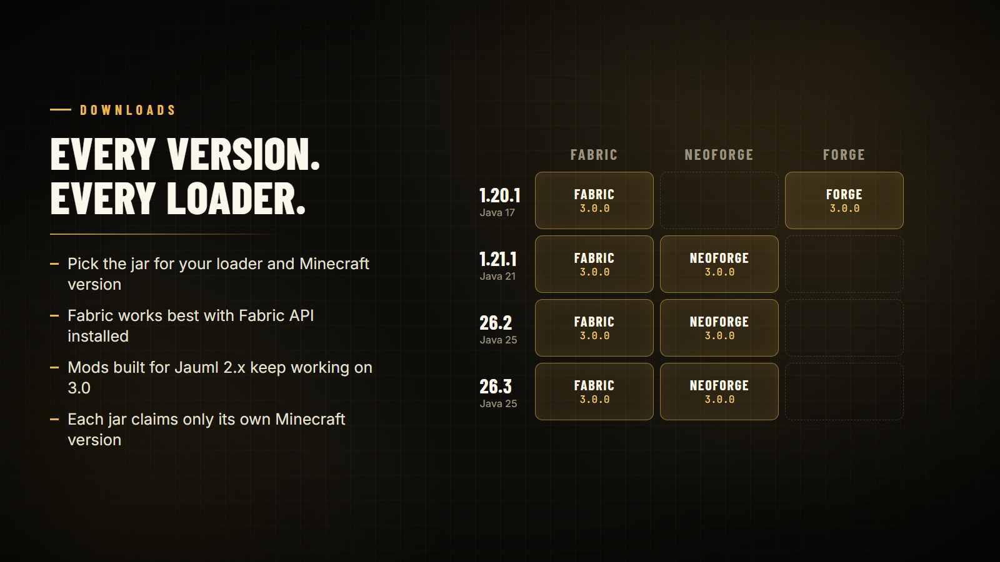

# Compatibility

Jauml 3.0 is built for Fabric, NeoForge and Forge on Minecraft 1.20.1, 1.21.1, 26.2 and 26.3, and mods built for Jauml 2.x run on it unchanged.

## Supported versions

| Minecraft | Loaders | Java | Also install |
| --- | --- | --- | --- |
| 1.20.1 | Fabric, Forge | 17 | Fabric API (Fabric, recommended) |
| 1.21.1 | Fabric, NeoForge | 21 | Fabric API (Fabric, recommended) |
| 26.2 | Fabric, NeoForge | 25 | Fabric API (Fabric, recommended) |
| 26.3 | Fabric, NeoForge | 25 | Fabric API (Fabric, recommended) |

## Library versions

| Jauml | Minecraft | Java | Gson |
| --- | --- | --- | --- |
| 2.0.0, 2.1.0, 2.3.0 | 1.20.1, 1.21.1, 1.21.11, 26.1.2, 26.2 | 17, 21, 25 | 2.10.x |
| 2.3.1 | 1.20.1, 1.21.1, 1.21.11, 26.1.2, 26.2, 26.3 | 17, 21, 25 | 2.10.x |
| **3.0.0** | 1.20.1, 1.21.1, 26.2, 26.3 | 17, 21, 25 | 2.10.x |

For Minecraft 1.21.11 or 26.1.2, keep Jauml 2.3.1.

## API compatibility

- 3.0 removes nothing from 2.x and changes no method signature. A test in the build pins every method released mods call.
- `JaumlConfig.isCompatible("2.x.y")` returns `true` on 3.x.
- Dependency ranges such as `[2.3.1,)` or `>=2.3.1` accept 3.0.0.
- `JaumlConfigLib` keeps every method for the whole 3.x line (deprecated, not marked for removal).

## Fabric notes

- Configs work without Fabric API; server events and the scheduler need it.
- Fabric on 1.20.1 needs Fabric Loader 0.16.10 or newer.
