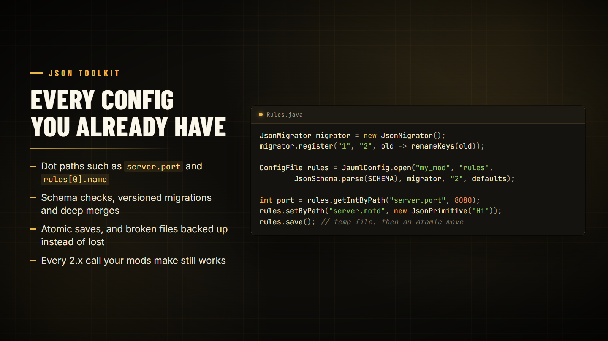

# JSON configs

The 2.x config API: open a JSON file as a `ConfigFile`, read it with typed getters and dot paths, validate it with a schema and upgrade it with migrations. All of it is still supported in 3.x.



## Open a file

```java
import tn.naizo.jauml.api.ConfigFile;
import tn.naizo.jauml.api.JaumlConfig;

ConfigFile config = JaumlConfig.open("my_mod", "settings"); // config/my_mod/settings.json
boolean enabled = config.getBoolean("enabled", true);
```

`JaumlConfig.open(...)` caches the instance per file. Call `JaumlConfig.invalidate("my_mod", "settings")` (or `clearCache()`) to get a fresh one from disk.

## Paths and the root object

```java
import com.google.gson.JsonObject;
import com.google.gson.JsonPrimitive;

String theme = config.getStringByPath("settings.theme", "dark");
int port = config.getIntByPath("server.port", 8080);
config.setByPath("settings.theme", new JsonPrimitive("light"));
config.save();

JsonObject root = config.asJsonObject(); // deep clone, safe to inspect
```

Paths support nested objects and list indexes, such as `users[0].name`.

## Saving and reloading

- Saves are atomic: Jauml writes a temporary file, then moves it over the old one.
- `config.setStableSave(true)` sorts keys alphabetically on save, for clean diffs.
- `config.reloadIfChanged()` reads the file again only when it changed on disk.
- `config.setBackupRotation(n)` keeps `n` generations of `.bak` files when a broken file is recovered.

## Schemas and defaults

```java
import tn.naizo.jauml.api.JsonSchema;

JsonSchema schema = JsonSchema.parse("{" +
    "\"type\":\"object\"," +
    "\"properties\":{" +
        "\"enabled\":{\"type\":\"boolean\"}," +
        "\"port\":{\"type\":\"number\"}" +
    "}" +
"}");

JsonObject defaults = new JsonObject();
defaults.addProperty("enabled", true);
defaults.addProperty("port", 8080);

ConfigFile config = JaumlConfig.open("my_mod", "settings", schema, defaults);
```

Besides `type` and `properties`, schemas can use `required`, `enum`, `minimum`/`maximum`, `minLength`/`maxLength`, `minItems`/`maxItems` and `additionalProperties: false`. Each is checked only when present.

## Migrations

```java
import tn.naizo.jauml.api.JsonLib;
import tn.naizo.jauml.api.JsonMigrator;

JsonMigrator migrator = new JsonMigrator();
migrator.setPreferredVersionKey("configVersion"); // optional
migrator.register("1.0", "2.0", old -> {
    JsonObject upgraded = JsonLib.deepClone(old).getAsJsonObject();
    upgraded.addProperty("enabled", true);
    return upgraded;
});

ConfigFile config = JaumlConfig.open("my_mod", "settings", schema, migrator, "2.0", defaults);
```

Steps run in order from the file's version to the target version. The same migrator works with [typed configs](typed-configs.md#builder-options).

## JsonLib

`JsonLib` holds the JSON helpers the rest of Jauml uses: safe parsing, path navigation, deep clone, deep merge, normalization and stable serialization.

## Legacy static helpers

`JaumlConfigLib`, the static helpers older mods call, keeps every method and signature for the whole 3.x line. It is deprecated in favour of `JaumlConfig` but not marked for removal, so compiling against it gives a deprecation warning only.
