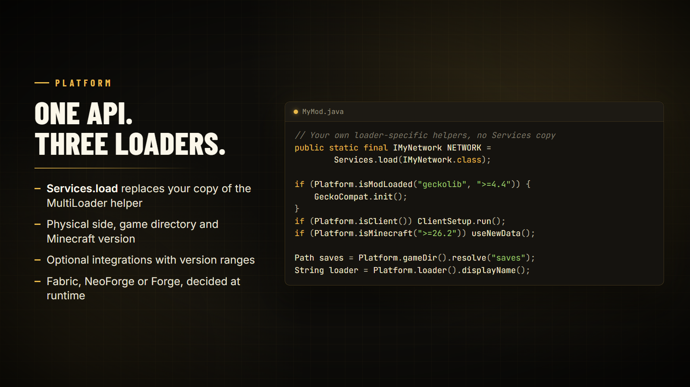

# Platform

One API for the things that differ between loaders: which loader is running, which side you're on, where the game folders are, and which mods and versions are loaded. `Services` loads your own loader-specific code.



## Platform

```java
import tn.naizo.jauml.platform.Platform;

if (Platform.isClient()) { /* physical client */ }
if (Platform.isModLoaded("geckolib", ">=4.4")) { /* optional integration */ }
if (Platform.isMinecraft(">=26.2")) { /* version-specific data */ }

Path saves = Platform.gameDir().resolve("saves");
String loader = Platform.loader().displayName(); // Fabric, NeoForge or Forge
```

| Method | Returns |
| --- | --- |
| `loader()` | The running `Loader`; also `isFabric()`, `isNeoForge()`, `isForge()` |
| `isClient()` / `isDedicatedServer()` | The physical side |
| `isDevelopment()` | `true` in a development environment |
| `gameDir()` / `configDir()` | The game and config directories |
| `minecraftVersion()` | The Minecraft version, such as `26.3` |
| `isMinecraft(range)` | Whether the Minecraft version is in a [version range](utilities.md#version-and-versionrange) |
| `isModLoaded(id)` / `isModLoaded(id, range)` | Whether a mod is loaded, optionally in a version range |
| `modVersion(id)` / `modVersionString(id)` | A loaded mod's version |
| `modName(id)` | A loaded mod's display name |
| `loadedMods()` | Every loaded mod id |

## Services

If your mod is built on the MultiLoader template, you can delete its copy of the `Services` class and `IPlatformHelper`: Jauml loads your own interfaces the same way, from the same `META-INF/services` files.

```java
import tn.naizo.jauml.platform.Services;

public static final IMyNetwork NETWORK = Services.load(IMyNetwork.class);
```

| Method | Behaviour |
| --- | --- |
| `Services.load(type)` | The single implementation; fails clearly when none is found |
| `Services.find(type)` | An `Optional`, for implementations that may be missing |
| `Services.loadAll(type)` | Every implementation found |

## Custom platform providers

`PlatformProvider` (in `tn.naizo.jauml.spi`) is what each loader module implements. Its newer methods (`getGameDirectory`, `isPhysicalClient`, `getModVersion`, `getModName`, `getLoadedModIds`, `getMinecraftVersion`) have defaults, so third-party implementations written for 2.x still compile.
