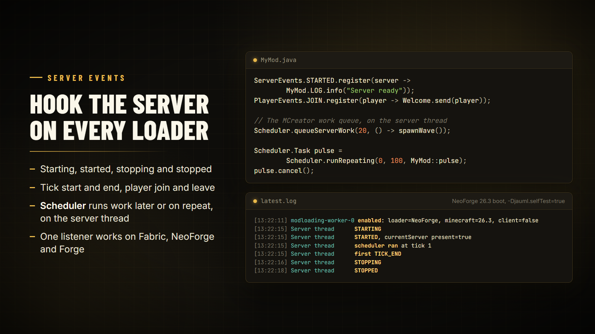

# Server events

Hook the server lifecycle, ticks and player joins once, in common code, and it works on Fabric, NeoForge and Forge, for dedicated and singleplayer servers.



## ServerEvents

```java
import tn.naizo.jauml.server.ServerEvents;

ServerEvents.STARTED.register(server -> MyMod.LOG.info("Server ready"));
ServerEvents.STOPPING.register(server -> MyData.flush());
ServerEvents.TICK_END.register(server -> MyMod.tick(server));

ServerEvents.currentServer().ifPresent(server -> ...); // between STARTING and STOPPED
```

| Event | Fires |
| --- | --- |
| `STARTING` | Before worlds load |
| `STARTED` | When the server is ready |
| `STOPPING` | When shutdown begins |
| `STOPPED` | After the server has stopped |
| `TICK_START` | At the start of every server tick |
| `TICK_END` | At the end of every server tick |

Every listener receives the `MinecraftServer`.

## PlayerEvents

```java
import tn.naizo.jauml.server.PlayerEvents;

PlayerEvents.JOIN.register(player -> Welcome.send(player));
PlayerEvents.LEAVE.register(player -> Sessions.close(player.getUUID()));
```

Listeners receive the `ServerPlayer`.

## Scheduler

```java
import tn.naizo.jauml.server.Scheduler;

Scheduler.runNextTick(() -> ...);
Scheduler.runLater(20, () -> spawnWave());          // in 20 ticks (1 second)
Scheduler.queueServerWork(20, () -> spawnWave());   // same meaning as the MCreator helper

Scheduler.Task pulse = Scheduler.runRepeating(0, 100, MyMod::pulse); // now, then every 5 seconds
pulse.cancel();

long tick = Scheduler.currentTick();
```

- Tasks run on the server thread at the end of a tick.
- Pending tasks are dropped when the server stops.
- `Task` has `cancel()`, `isCancelled()` and `isDone()`.
- `Scheduler.pendingTasks()` tells you how many are queued.

## Priorities and unregistering

Every event is an [`Event`](utilities.md#event): register with a priority to run before or after other listeners, and unregister when you no longer need it.

```java
ServerEvents.TICK_END.register(Event.PRIORITY_HIGH, server -> ...);
ServerEvents.TICK_END.unregister(myListener);
```

## Fabric needs Fabric API

On Fabric these events come from Fabric API. Without it Jauml logs a warning and the events and scheduler don't fire; configs still work.

## Check it on a real boot

Start a server with `-Djauml.selfTest=true` and Jauml logs every server event and one scheduler run. The card above shows that log from a NeoForge 26.3 server.
