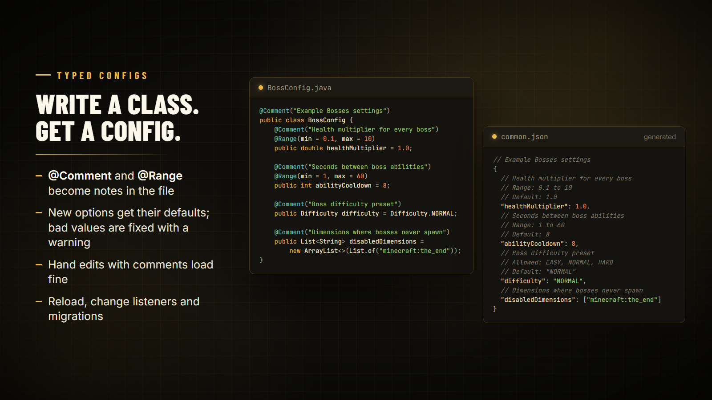

# Typed configs

Write your settings as a plain Java class and bind it to a JSON file. Public fields are the options, field initializers are the defaults, and the file is written with comments players can read.



## Bind a class

```java
import tn.naizo.jauml.api.JaumlConfig;
import tn.naizo.jauml.config.Comment;
import tn.naizo.jauml.config.Range;
import tn.naizo.jauml.config.TypedConfig;

@Comment("My Mod settings")
public class MyConfig {
    @Comment("Maximum boss level")
    @Range(min = 1, max = 100)
    public int maxLevel = 50;

    public List<String> blockedDimensions = new ArrayList<>();
    public Drops drops = new Drops(); // nested classes become nested objects
}

public static final TypedConfig<MyConfig> CONFIG = JaumlConfig.bind("my_mod", "common", MyConfig.class);
```

That creates `config/my_mod/common.json` on first use. Read values through `get()`:

```java
int max = CONFIG.get().maxLevel;
```

Always go through `get()` rather than keeping the object: a reload swaps in a new instance.

## What the file looks like

Each option gets `//` lines with its `@Comment` text, its `@Range` bounds, the allowed values of an enum, and its default. The class-level `@Comment` goes at the top. Players can add their own comments too; the file still loads.

## Safe loading

| Situation | What happens |
| --- | --- |
| A key is missing | It gets its default and is written back |
| A value has the wrong type | It is converted when possible, otherwise reset to the default, with a warning |
| A number is outside its `@Range` | It is clamped to the range, with a warning |
| The file doesn't parse at startup | It is moved to `<name>.json.bak` and replaced with defaults |
| The file breaks during `reload()` | The previous values stay in use |
| A player removes a map entry | It stays removed |

## Change values and react to changes

```java
CONFIG.update(c -> c.maxLevel = 75);      // edit, clamp, save and notify listeners
CONFIG.addListener(c -> rebuildCaches(c)); // runs after every load, reload and update
CONFIG.resetToDefaults();
CONFIG.save();
```

## Reload

```java
CONFIG.reload();          // read the file again
CONFIG.reloadIfChanged(); // only when the file changed on disk

// Optional hot reload every 5 seconds, on the server thread:
Scheduler.runRepeating(100, 100, CONFIG::reloadIfChanged);
```

Both return `true` when new values were loaded.

## Builder options

```java
TypedConfig<MyConfig> config = TypedConfig.builder(MyConfig.class)
    .file("my_mod", "common")        // or .path(somePath)
    .migrator(migrator, "2")         // run JsonMigrator steps before binding
    .comments(false)                 // plain JSON without // comments
    .build();
```

With a migrator, renamed or moved options carry over before the class is bound. See [JSON configs](json-configs.md#migrations) for writing migration steps.

## Don't mix the two config APIs on one file

Don't open a commented typed-config file with `JaumlConfig.open(...)`. `ConfigFile` parses strictly and would treat the comments as corruption.
