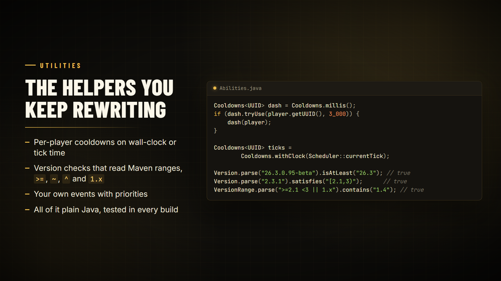

# Utilities

The small helpers mods keep rewriting: cooldowns, version comparison and ranges, and a listener list for your own events.



## Cooldowns

Per-key cooldowns (per player UUID, per entity, per ability), replacing a hand-rolled `Map<UUID, Long>`. Thread-safe.

```java
import tn.naizo.jauml.util.Cooldowns;

private static final Cooldowns<UUID> DASH = Cooldowns.millis();

if (DASH.tryUse(player.getUUID(), 3_000)) {
    dash(player);
} else {
    tell(player, DASH.remaining(player.getUUID()) + " ms left");
}
```

- `Cooldowns.millis()` measures wall-clock milliseconds, so cooldowns keep running while the game is paused or lagging.
- `Cooldowns.withClock(Scheduler::currentTick)` measures server ticks instead, or any clock you pass.
- Also: `start`, `isCoolingDown`, `remaining`, `reset`, `clear`, `prune` and `size`. Expired entries are dropped when touched or by `prune()`.

## Version and VersionRange

```java
import tn.naizo.jauml.util.Version;

Version.parse("26.3.0.95-beta").isAtLeast("26.3");
Version.parse("2.3.1").satisfies("[2.1,3)");
```

Versions such as `1.20.1`, `26.3.0.95-beta` and `0.165.0+26.3` compare the way you'd expect. Ranges can be written as:

| Form | Example |
| --- | --- |
| Maven | `[2.1,3)` |
| Comparators | `>=2.1 <3` |
| Tilde and caret | `~2.3`, `^2` |
| Wildcard | `1.x` |
| Alternatives | `>=26.2 \|\| 1.21.1` |

The same ranges work in [`Platform.isModLoaded`](platform.md) and `Platform.isMinecraft`.

## Event

A small listener list for your own events. Listeners run in priority order (higher first), then in registration order.

```java
import tn.naizo.jauml.event.Event;

public static final Event<Runnable> RELOADED = Event.create(listeners -> () -> listeners.forEach(Runnable::run));

RELOADED.register(() -> ...);
RELOADED.register(Event.PRIORITY_HIGH, () -> ...); // PRIORITY_HIGH = 100, NORMAL = 0, LOW = -100
RELOADED.invoker().run();
```

`unregister(listener)` and `listenerCount()` are there too. [Server events](server-events.md) are built on this class.

## Other helpers

| Class | Use |
| --- | --- |
| `PlatformUtil` | `isDevelopmentEnvironment()` and other environment checks |
| `JaumlLogger` | A small logging wrapper |
| `ModuleVersion` | Version and compatibility checks for optional modules |
| `Lifecycle` | `requireCompatibleLibrary("2.0.0")` and `onStartup(modId, task)` |

```java
import tn.naizo.jauml.util.Lifecycle;
import tn.naizo.jauml.util.ModuleVersion;

Lifecycle.requireCompatibleLibrary("2.0.0");
Lifecycle.onStartup("my_mod", () -> { /* startup work */ });

ModuleVersion storage = new ModuleVersion("jauml-storage", "1.2.0");
if (storage.isCompatibleWith("1.0.0")) { /* safe to use */ }
```
